# FarmConnect - Database Entity Relationship Diagram (ERD)

This document specifies the PostgreSQL relational database schema for **FarmConnect**, covering the core MVP (Machinery Rental) and extensibility for future phases (Reviews, Notifications, Farm Labour, and AnimalConnect). For detailed architectural specifications and milestone roadmaps, refer to [PROJECT_PLAN.md](PROJECT_PLAN.md).

---

## 1. Mermaid Entity Relationship Diagram

```mermaid
erDiagram
    %% Core User & Profile Entities
    USERS ||--o| USER_LOCATIONS : "has primary/secondary"
    USERS ||--o| PROVIDER_PROFILES : "may have"
    USERS ||--o{ BOOKINGS : "places as farmer"
    USERS ||--o{ BOOKING_STATUS_HISTORY : "triggers action as"
    USERS ||--o{ CONTACT_ENQUIRIES : "submits (optional)"

    %% Machinery Entities
    PROVIDER_PROFILES ||--o{ MACHINERY : "owns and lists"
    MACHINERY ||--o{ MACHINERY_PHOTOS : "has images"
    MACHINERY ||--o{ MACHINERY_RATES : "defines rental rates for"
    MACHINERY ||--o{ MACHINERY_AVAILABILITY : "has custom blackout windows"
    MACHINERY ||--o{ BOOKINGS : "is booked for"

    %% Booking Lifecycle Entities
    BOOKINGS ||--o{ BOOKING_STATUS_HISTORY : "tracks timeline of"

    %% Future Extensibility Entities (Phases 2-4)
    USERS ||--o{ NOTIFICATIONS : "receives"
    BOOKINGS ||--o| REVIEWS : "can be reviewed"
    USERS ||--o{ REVIEWS : "authored by"
    USERS ||--o| LABOUR_PROFILES : "registers as labourer"
    USERS ||--o{ LIVESTOCK_LISTINGS : "posts animal sale/rent"
    LIVESTOCK_LISTINGS ||--o{ LIVESTOCK_PHOTOS : "has animal photos"

    USERS {
        uuid id PK
        varchar phone UK "Indexed, Normalized E.164"
        varchar role "FARMER, PROVIDER, ADMIN"
        varchar full_name
        varchar password_hash "Nullable for OTP-only users; required for Admin"
        varchar preferred_language "en or ta"
        boolean is_active
        boolean is_phone_verified
        timestamp last_login_at
        timestamp created_at
        timestamp updated_at
    }

    USER_LOCATIONS {
        uuid id PK
        uuid user_id FK
        varchar address_line
        varchar village_or_town "Indexed"
        varchar district "Indexed"
        varchar state
        varchar pincode "Indexed"
        numeric latitude "Nullable (manual or GPS)"
        numeric longitude "Nullable (manual or GPS)"
        boolean is_primary
        timestamp created_at
        timestamp updated_at
    }

    PROVIDER_PROFILES {
        uuid id PK
        uuid user_id FK "1:1 with USERS"
        varchar business_name
        varchar alternate_phone
        boolean whatsapp_enabled "Provider consent flag"
        varchar whatsapp_number
        varchar verification_status "PENDING, VERIFIED, SUSPENDED"
        text bio_description
        timestamp created_at
        timestamp updated_at
    }

    MACHINERY {
        uuid id PK
        uuid provider_id FK
        varchar name_en
        varchar name_ta
        varchar category "TRACTOR, HARVESTER, TILLER, SPRAYER, BALER, OTHER"
        varchar make_model
        integer model_year
        integer horsepower
        text description_en
        text description_ta
        varchar village_or_town "Machinery base location"
        varchar district
        varchar pincode
        numeric latitude
        numeric longitude
        boolean is_active "Soft toggle by provider"
        timestamp created_at
        timestamp updated_at
    }

    MACHINERY_PHOTOS {
        uuid id PK
        uuid machinery_id FK
        varchar photo_url
        boolean is_primary
        integer display_order
        timestamp created_at
    }

    MACHINERY_RATES {
        uuid id PK
        uuid machinery_id FK
        varchar rental_option_type "MACHINE_ONLY, MACHINE_OPERATOR, MACHINE_OPERATOR_LABOUR"
        numeric rate_per_hour
        numeric rate_per_day
        integer min_booking_duration_hours
        numeric security_deposit
        timestamp created_at
        timestamp updated_at
    }

    MACHINERY_AVAILABILITY {
        uuid id PK
        uuid machinery_id FK
        timestamp unavailable_from
        timestamp unavailable_to
        varchar reason "MAINTENANCE, PERSONAL_USE, SEASONAL_OFF"
        timestamp created_at
    }

    BOOKINGS {
        uuid id PK
        varchar booking_reference UK "e.g. FC-2026-XXXX"
        uuid farmer_id FK
        uuid machinery_id FK
        varchar rental_option_type "MACHINE_ONLY, MACHINE_OPERATOR, MACHINE_OPERATOR_LABOUR"
        timestamp start_time
        timestamp end_time
        numeric estimated_total_cost "Advisory quote for offline settlement"
        varchar status "PENDING, APPROVED, IN_PROGRESS, COMPLETED, CANCELLED, REJECTED"
        text delivery_address
        varchar contact_phone_snapshot
        text notes
        timestamp created_at
        timestamp updated_at
    }

    BOOKING_STATUS_HISTORY {
        uuid id PK
        uuid booking_id FK
        varchar from_status
        varchar to_status
        uuid changed_by_user_id FK
        text reason_or_comment
        timestamp changed_at
    }

    CONTACT_ENQUIRIES {
        uuid id PK
        uuid user_id FK "Nullable for guest enquiries"
        varchar sender_name
        varchar contact_phone_or_email
        varchar subject
        text message
        varchar status "NEW, IN_PROGRESS, RESOLVED"
        text admin_notes
        timestamp created_at
        timestamp updated_at
    }

    REVIEWS {
        uuid id PK
        uuid booking_id FK "1:1 unique"
        uuid reviewer_id FK
        uuid reviewee_id FK
        integer rating "1 to 5"
        text comment
        timestamp created_at
    }

    NOTIFICATIONS {
        uuid id PK
        uuid user_id FK
        varchar title
        text message
        varchar notification_type "BOOKING_REQUEST, STATUS_UPDATE, SYSTEM"
        boolean is_read
        timestamp created_at
    }

    LABOUR_PROFILES {
        uuid id PK
        uuid user_id FK
        varchar skill_category "HARVESTING, PLOWING, WEEDING, GENERAL"
        numeric daily_wage
        integer team_size
        varchar district
        varchar pincode
        boolean is_available
        timestamp created_at
    }

    LIVESTOCK_LISTINGS {
        uuid id PK
        uuid user_id FK
        varchar animal_type "CATTLE, GOAT, SHEEP, POULTRY, OTHER"
        varchar breed
        integer age_months
        numeric price
        varchar listing_type "SALE, BREEDING, RENTAL"
        varchar district
        varchar pincode
        boolean is_active
        timestamp created_at
    }

    LIVESTOCK_PHOTOS {
        uuid id PK
        uuid livestock_id FK
        varchar photo_url
        boolean is_primary
        timestamp created_at
    }
```



---

## 2. Booking Status Lifecycle & State Machine

The platform enforces **six canonical booking statuses**:

| Status | Meaning & Ownership | Valid Next Transitions |
| :--- | :--- | :--- |
| **`PENDING`** | Booking created by farmer; awaiting provider review. | `APPROVED` (Provider), `REJECTED` (Provider), `CANCELLED` (Farmer) |
| **`APPROVED`** | Provider accepted request; machine reserved. | `IN_PROGRESS` (Provider/System), `CANCELLED` (Farmer/Provider before start) |
| **`IN_PROGRESS`**| Equipment dispatched/in field operation. | `COMPLETED` (Provider) |
| **`COMPLETED`** | Equipment returned, work finished, offline payment settled. | *Terminal state* (Eligible for review in Phase 2) |
| **`CANCELLED`** | Booking cancelled prior to equipment deployment. | *Terminal state* |
| **`REJECTED`**  | Provider declined request with reason. | *Terminal state* |

Every state change creates an immutable audit record in `BOOKING_STATUS_HISTORY` capturing `from_status`, `to_status`, `changed_by_user_id`, and `reason_or_comment`.

---

## 3. Table Schemas, Constraints & Business Rules

### A. Overlapping Booking Prevention Architecture
To guarantee that no machine can have overlapping active bookings (status `APPROVED` or `IN_PROGRESS`), the system employs a two-layer defense mechanism:

1. **Database-Level Constraint (PostgreSQL `EXCLUDE` constraint with GiST index)**:
   ```sql
   -- Requires btree_gist extension in PostgreSQL
   CREATE EXTENSION IF NOT EXISTS btree_gist;

   ALTER TABLE bookings
   ADD CONSTRAINT exclude_overlapping_confirmed_bookings
   EXCLUDE USING gist (
       machinery_id WITH =,
       tsrange(start_time, end_time, '[)') WITH &&
   )
   WHERE (status IN ('APPROVED', 'IN_PROGRESS'));
   ```
   *Rationale:* Unlike purely application-level checks that are vulnerable to race conditions under concurrent requests, PostgreSQL's exclusion constraint guarantees zero double-bookings at the storage layer.

2. **Application-Level Transactional Guard**:
   Before updating a booking status to `APPROVED`, the provider approval endpoint executes:
   ```sql
   SELECT id FROM bookings
   WHERE machinery_id = :machine_id
     AND status IN ('APPROVED', 'IN_PROGRESS')
     AND tsrange(start_time, end_time, '[)') && tsrange(:start, :end, '[)')
   FOR UPDATE;
   ```
   If records are returned, the approval transaction aborts with a 409 Conflict error and a localized error message.

---

### B. Foreign Key Cascade & Integrity Rules

| Parent Table | Child Table | Relationship | On Delete Action | Business Reason |
| :--- | :--- | :--- | :--- | :--- |
| `USERS` | `USER_LOCATIONS` | 1 : N | `CASCADE` | User deletion removes associated personal addresses. |
| `USERS` | `PROVIDER_PROFILES` | 1 : 1 | `RESTRICT` | Prevent accidental deletion of providers with active listings or transaction history. |
| `PROVIDER_PROFILES` | `MACHINERY` | 1 : N | `RESTRICT` | Machinery history and active rental contracts must be retained. |
| `MACHINERY` | `MACHINERY_PHOTOS` | 1 : N | `CASCADE` | Deleting a machinery listing removes its photo references. |
| `MACHINERY` | `MACHINERY_RATES` | 1 : N | `CASCADE` | Rates belong strictly to the machinery listing. |
| `MACHINERY` | `MACHINERY_AVAILABILITY` | 1 : N | `CASCADE` | Blackout dates are subordinate to the machine entity. |
| `USERS` | `BOOKINGS` (Farmer) | 1 : N | `RESTRICT` | Prevent deletion of users who have ongoing or audit-relevant bookings. |
| `MACHINERY` | `BOOKINGS` | 1 : N | `RESTRICT` | Prevent deletion of machinery with past or active booking records. |
| `BOOKINGS` | `BOOKING_STATUS_HISTORY`| 1 : N | `CASCADE` | Audit logs follow booking lifecycle. |
| `BOOKINGS` | `REVIEWS` | 1 : 1 | `RESTRICT` | Retain reviews tied to historical bookings. |

---

### C. Indexing Strategy for High-Performance Queries

1. **Geographic & Location Search**:
   - `CREATE INDEX idx_machinery_district ON machinery(district);`
   - `CREATE INDEX idx_machinery_pincode ON machinery(pincode);`
   - `CREATE INDEX idx_machinery_village ON machinery(village_or_town);`
   - `CREATE INDEX idx_machinery_active ON machinery(is_active);`
   - Compound index: `CREATE INDEX idx_machinery_search ON machinery(district, category, is_active);`
   - Spatial coordinates: `CREATE INDEX idx_machinery_coords ON machinery(latitude, longitude);`

2. **Booking Date Search & Validation**:
   - `CREATE INDEX idx_bookings_machine_dates ON bookings (machinery_id, start_time, end_time, status);`
   - `CREATE INDEX idx_bookings_farmer ON bookings (farmer_id, created_at DESC);`
   - `CREATE INDEX idx_bookings_ref ON bookings (booking_reference);`

3. **Authentication & Identity**:
   - `CREATE UNIQUE INDEX idx_users_phone ON users(phone);`
   - `CREATE INDEX idx_users_role ON users(role);`
