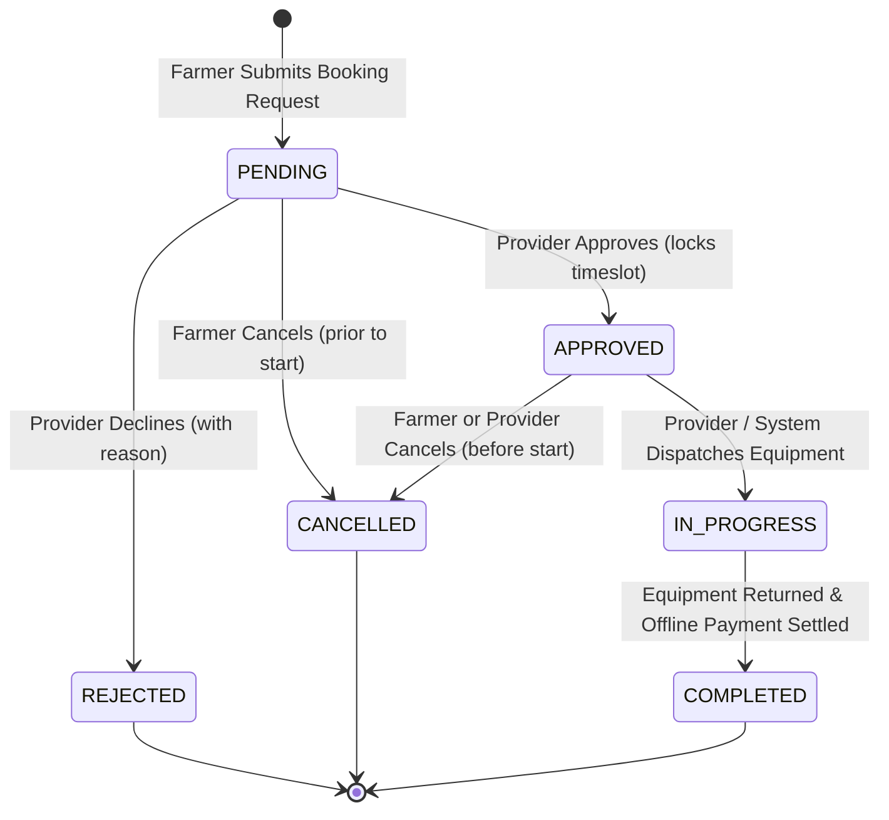
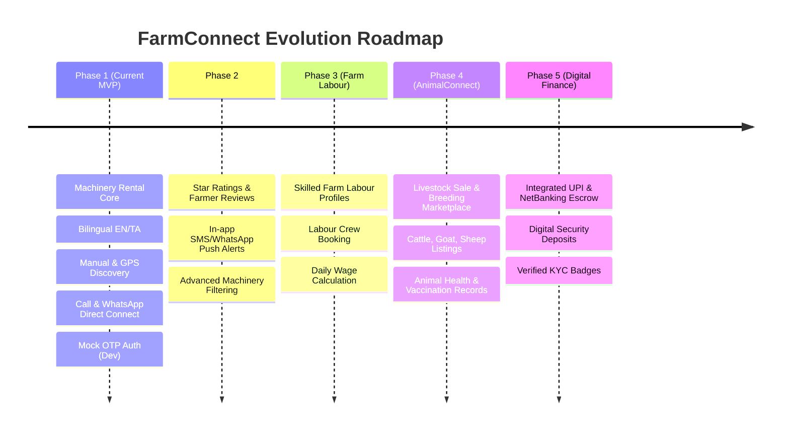

# FarmConnect - Comprehensive Project Plan & Architecture Specification

## 1. Executive Summary & Project Goal
**FarmConnect** is a responsive, bilingual (English & Tamil) web platform designed to bridge the gap between rural farmers and agricultural equipment owners. Modern mechanized farming requires access to tractors, harvesters, tillers, and sprayers; however, smallholder farmers often lack the capital to purchase machinery, while equipment owners experience idle asset capacity.

FarmConnect enables farmers to:
- Discover nearby agricultural machinery based on manual administrative location (village, town, district, PIN code) or optional GPS coordinates.
- Evaluate equipment specifications, photo galleries, verified provider credentials, and flexible rental options (*Machine only*, *Machine + operator*, or *Machine + operator + labour*).
- Submit booking requests with instant price estimations.
- Communicate directly with machinery owners via click-to-call or provider-consented WhatsApp.
- Track booking statuses (**Pending, Approved, In Progress, Completed, Cancelled, Rejected**) with full audit transparency.

The platform is designed with a phased delivery methodology, prioritizing a robust **Machinery Rental Minimum Viable Product (Phase 1 MVP)** before expanding into **Farm Labour** (Phase 3) and **AnimalConnect** (Phase 4).

---

## 2. Technology Stack & Architectural Principles

| Layer | Selected Technology | Rationale & Standards |
| :--- | :--- | :--- |
| **Frontend** | HTML5, Vanilla CSS, Modular Vanilla JavaScript | High performance, lightweight footprint on low-bandwidth rural connections, zero compilation overhead, maximum styling control without third-party framework lock-in. |
| **Styling & Aesthetics** | Custom Modern CSS Design System | Curated agricultural color palette (earthy greens `#2D6A4F`, warm gold `#DDA15E`, clean neutrals `#F8F9FA`, deep charcoal `#1B4332`), responsive mobile-first layouts, accessible touch targets (minimum 44px), high contrast readability. |
| **Internationalization (i18n)** | English (`en`) & Tamil (`ta`) bilingual architecture | Dual-language client dictionary system + localized database text fields (`name_en`, `name_ta`, `description_en`, `description_ta`). |
| **Backend** | Python Flask (v3.x) | Application factory pattern (`create_app`), modular Blueprints, high maintainability, standard Python ecosystem. |
| **Database** | PostgreSQL | Relational integrity, ACID compliance, advanced indexing, and native `tsrange` exclusion constraints for rock-solid double-booking prevention. |
| **ORM & Migrations** | Flask-SQLAlchemy & Flask-Migrate (Alembic) | Pythonic schema definitions, declarative models, trackable and reversible schema migrations. |
| **Authentication** | Mobile Phone OTP (Farmers & Providers) / Password (Admin) | Session-based authentication with secure HTTP-only cookies; phone OTP via SMS is the primary auth flow for farmers and providers; password hashing via `werkzeug.security` for administrator access; mock OTP strictly isolated to local development. |
| **Development & Version Control**| Antigravity IDE, Git & GitHub | Environment isolation via virtual environments (`venv`), secrets protected by `.env` and `.gitignore`. |

---

## 3. Confirmed Decisions, Assumptions & Unresolved Decisions

### A. Confirmed Decisions
1. **Phased Approach**: Project Phase 1 exclusively implements the Machinery Rental MVP. Subsequent phases integrate Reviews & Notifications (Phase 2), Farm Labour (Phase 3), AnimalConnect (Phase 4), and Online Payments (Phase 5).
2. **Machinery Rental Packages**: Three distinct booking tiers:
   - `MACHINE_ONLY`: Machine rental without personnel.
   - `MACHINE_OPERATOR`: Machine rental including a skilled operator.
   - `MACHINE_OPERATOR_LABOUR`: Machine rental including an operator and supplementary farm field labourers.
3. **Bilingual Support**: Full user interface available in Tamil and English with instant switching and language preference persistence.
4. **Dual Location Discovery**:
   - Primary: Manual administrative entry (Village/Town, District, PIN code).
   - Secondary: Optional browser GPS geolocation with explicit user permission.
5. **Authentication Flow**: Phone number-based identity verification. Mock OTP generator for local development; clean abstraction layer for plugging in a real SMS provider.
6. **No Online Payments in Phase 1**: Cash on delivery / direct offline settlement between farmer and provider upon job fulfillment. Payment gateway integration deferred to Phase 5.
7. **Direct Contact**: Telephonic call action using verified provider phone numbers, and optional WhatsApp chat button subject to explicit provider privacy consent.
8. **Double-Booking Protection**: Absolute prevention of overlapping confirmed bookings for any single machine at the database and application levels.

### B. Core Assumptions
1. **Currency & Timezone**: All financial figures are denominated in Indian Rupees (INR - ₹). Operational timezone is Indian Standard Time (IST - UTC+05:30).
2. **Target Geography**: Initial geographical rollout focuses on districts of Tamil Nadu (e.g., Thanjavur, Madurai, Coimbatore, Tiruchirappalli, Salem, Erode).
3. **SMS Mocking & Security Isolation**: In development mode (`APP_ENV=development`), mock OTP is logged strictly to the local Flask server console for testing. The application explicitly validates the environment configuration on startup, strictly rejecting `MOCK_OTP_ENABLED=True` in production (`APP_ENV=production`), and OTP codes are never exposed in JSON API response bodies.
4. **Photo Storage**: In Phase 1, machinery photos are securely uploaded to a local static assets directory (`/static/uploads/machinery/`) with unique UUID filenames and file signature validation.

### C. Unresolved Decisions (To Be Finalized)
1. **Production SMS Gateway Provider**: Selection between Twilio, Fast2SMS, MSG91, or AWS SNS for production OTP delivery (pluggable service adapter ready).
2. **Spatial Search Implementation**: Choice between pure Haversine SQL formula vs. PostgreSQL `earthdistance` / `PostGIS` extension for radius searches. (Haversine SQL approach recommended for Phase 1 to avoid binary C-extension setup overhead on local PostgreSQL instances).
3. **Admin Pre-Approval vs. Post-Moderation**: Whether providers must undergo manual admin verification before their machinery listings appear publicly, or if listings go live immediately with an "Unverified" badge.

---

## 4. User Roles, Workflows & Booking State Machine

### A. User Roles & Permissions
```
+-----------------------------------------------------------------------+
|                              USER ROLES                               |
+-------------------+-------------------+-------------------------------+
| Farmer            | Provider          | Admin                         |
+-------------------+-------------------+-------------------------------+
| - Browse catalog  | - All Farmer      | - System overview dashboard   |
| - Filter & search |   capabilities    | - Provider verification       |
| - Request booking | - Register profile| - Listing moderation          |
| - Cancel booking  | - List machinery  | - View all bookings & audits  |
| - View history    | - Set pricing     | - Contact enquiry management  |
| - Call/WhatsApp   | - Set blackout    | - User management             |
|   provider        | - Approve/Reject  |                               |
|                   | - Start/Complete  |                               |
+-------------------+-------------------+-------------------------------+
```

### B. The Six Booking Statuses & Lifecycle Rules

The system governs bookings through six canonical states:



1. **`PENDING`**: Initial request generated by farmer. Machine availability is tentative.
2. **`APPROVED`**: Provider accepts request. Overlapping booking exclusion locks the timeslot against double-booking.
3. **`IN_PROGRESS`**: Rental commences; equipment is deployed in field operation. The timeslot remains locked.
4. **`COMPLETED`**: Work is completed, equipment is returned, and offline payment is settled between parties.
5. **`CANCELLED`**: Cancelled by farmer (or provider) before equipment dispatch. Releases timeslot.
6. **`REJECTED`**: Declined by provider with reason. Releases timeslot.

### C. Farmer Booking Lifecycle Sequence Diagram
```mermaid
sequenceDiagram
    autonumber
    actor Farmer as Farmer (User)
    participant UI as Web Frontend (EN/TA)
    participant Server as Flask Backend
    participant DB as PostgreSQL Database
    actor Provider as Machinery Provider

    Farmer->>UI: Selects location (Village/Pincode/GPS) & Machinery Category
    UI->>Server: GET /api/machinery?district=...&category=...
    Server->>DB: Query active machinery with rates & location
    DB-->>Server: Return machinery list
    Server-->>UI: Render bilingual listing cards
    Farmer->>UI: Selects machine, chooses Rental Option & Start/End Dates
    UI->>Server: POST /api/bookings/estimate (Calculate estimate)
    Server-->>UI: Displays advisory cost quote & terms
    Farmer->>UI: Confirms & clicks "Request Booking"
    UI->>Server: POST /api/bookings (Create booking in PENDING status)
    Server->>DB: Check for existing APPROVED/IN_PROGRESS overlaps; Insert booking (PENDING)
    Server-->>UI: Booking Reference generated (e.g. FC-2026-0814)
    UI-->>Farmer: Confirmation banner with "Call Provider" / "WhatsApp" button
    
    Server->>Provider: Notification/Dashboard alert: New booking request
    Provider->>UI: Reviews booking request in Provider Dashboard
    alt Provider Approves
        Provider->>UI: Clicks "Approve"
        UI->>Server: PATCH /api/provider/bookings/{id}/approve
        Server->>DB: Atomic lock check & Update status to APPROVED
        DB-->>Server: Status updated
        Server-->>UI: Success confirmation
        Note over Farmer,Provider: Timeslot locked. Farmer sees APPROVED status.
        Provider->>UI: Clicks "Start Rental" on start date
        UI->>Server: PATCH /api/provider/bookings/{id}/start
        Server->>DB: Update status to IN_PROGRESS
        Provider->>UI: Clicks "Mark Completed" upon job completion
        UI->>Server: PATCH /api/provider/bookings/{id}/complete
        Server->>DB: Update status to COMPLETED & record offline settlement
    else Provider Rejects
        Provider->>UI: Clicks "Reject" with reason
        UI->>Server: PATCH /api/provider/bookings/{id}/reject
        Server->>DB: Update status to REJECTED & record reason in history
        Server-->>UI: Booking marked REJECTED
    end
```

### D. Provider Onboarding & Machinery Management Workflow
1. **Registration**: User registers with phone number, completes OTP verification, and selects "Provider" or switches profile to Provider.
2. **Business Details**: Enters business name, village/town, district, PIN code, and specifies whether WhatsApp contact is enabled for booking enquiries.
3. **Machinery Listing Creation**:
   - Specifies equipment name (English & Tamil), category (Tractor, Harvester, Tiller, Sprayer, Baler, etc.), make, model year, horsepower.
   - Uploads up to 5 clear photographs (identifies primary photo).
   - Configures rates for applicable packages (`MACHINE_ONLY`, `MACHINE_OPERATOR`, `MACHINE_OPERATOR_LABOUR`) with hourly and daily pricing.
   - Configures custom blackout dates (e.g., scheduled maintenance).
4. **Order Execution & Completion**:
   - Provider inspects pending requests, reviews requested dates and delivery address.
   - Approves request (`APPROVED`), dispatches machine (`IN_PROGRESS`), and upon return, marks booking as `COMPLETED`.

---

## 5. Database Schema & Relational Model

The full visual schema, entity attributes, and index designs are documented in [DATABASE_ER_DIAGRAM.md](DATABASE_ER_DIAGRAM.md).

### A. Core Relational Tables
1. **`users`**:
   - Identifiers: `id` (UUID, PK), `phone` (VARCHAR(15), UNIQUE, Normalized E.164), `full_name`, `password_hash` (Nullable for OTP-only farmers/providers; required for admin), `role` (`FARMER`, `PROVIDER`, `ADMIN`), `preferred_language` (`en` or `ta`), `is_active`, `is_phone_verified`.
2. **`user_locations`**:
   - Normalized addresses: `id` (UUID, PK), `user_id` (FK -> `users.id`), `address_line`, `village_or_town`, `district`, `state`, `pincode`, `latitude`, `longitude`, `is_primary`.
3. **`provider_profiles`**:
   - Provider metadata: `id` (UUID, PK), `user_id` (FK -> `users.id`, 1:1), `business_name`, `alternate_phone`, `whatsapp_enabled` (BOOLEAN default FALSE), `whatsapp_number`, `verification_status` (`PENDING`, `VERIFIED`, `SUSPENDED`), `bio_description`.
4. **`machinery`**:
   - Asset catalog: `id` (UUID, PK), `provider_id` (FK -> `provider_profiles.id`), `name_en`, `name_ta`, `category`, `make_model`, `model_year`, `horsepower`, `description_en`, `description_ta`, `village_or_town`, `district`, `pincode`, `latitude`, `longitude`, `is_active`.
5. **`machinery_photos`**:
   - Asset imagery: `id` (UUID, PK), `machinery_id` (FK -> `machinery.id`), `photo_url`, `is_primary`, `display_order`.
6. **`machinery_rates`**:
   - Pricing models: `id` (UUID, PK), `machinery_id` (FK -> `machinery.id`), `rental_option_type` (`MACHINE_ONLY`, `MACHINE_OPERATOR`, `MACHINE_OPERATOR_LABOUR`), `rate_per_hour`, `rate_per_day`, `min_booking_duration_hours`, `security_deposit` (Advisory amount for offline terms).
7. **`machinery_availability`**:
   - Blackout calendar: `id` (UUID, PK), `machinery_id` (FK -> `machinery.id`), `unavailable_from`, `unavailable_to`, `reason`.
8. **`bookings`**:
   - Rental contracts: `id` (UUID, PK), `booking_reference` (VARCHAR(20), UNIQUE), `farmer_id` (FK -> `users.id`), `machinery_id` (FK -> `machinery.id`), `rental_option_type`, `start_time`, `end_time`, `estimated_total_cost` (Advisory quote for offline settlement), `status` (`PENDING`, `APPROVED`, `IN_PROGRESS`, `COMPLETED`, `CANCELLED`, `REJECTED`), `delivery_address`, `contact_phone_snapshot`, `notes`.
9. **`booking_status_history`**:
   - State transition audit: `id` (UUID, PK), `booking_id` (FK -> `bookings.id`), `from_status`, `to_status`, `changed_by_user_id` (FK -> `users.id`), `reason_or_comment`, `changed_at`.
10. **`contact_enquiries`**:
    - Support ticketing: `id` (UUID, PK), `user_id` (FK -> `users.id`, NULLABLE), `sender_name`, `contact_phone_or_email`, `subject`, `message`, `status` (`NEW`, `IN_PROGRESS`, `RESOLVED`), `admin_notes`.

### B. Double-Booking Prevention Implementation
The platform strictly ensures that no machine can have overlapping `APPROVED` or `IN_PROGRESS` bookings:
- **Storage Layer**: PostgreSQL exclusion constraint using the `btree_gist` extension:
  ```sql
  CREATE EXTENSION IF NOT EXISTS btree_gist;
  ALTER TABLE bookings
  ADD CONSTRAINT exclude_overlapping_confirmed_bookings
  EXCLUDE USING gist (
      machinery_id WITH =,
      tsrange(start_time, end_time, '[)') WITH &&
  )
  WHERE (status IN ('APPROVED', 'IN_PROGRESS'));
  ```
- **Application Layer**: In `approve_booking()`, an explicit row-level lock check (`FOR UPDATE`) verifies zero overlapping confirmed intervals before applying state transitions:
  ```sql
  SELECT id FROM bookings
  WHERE machinery_id = :machine_id
    AND status IN ('APPROVED', 'IN_PROGRESS')
    AND tsrange(start_time, end_time, '[)') && tsrange(:start, :end, '[)')
  FOR UPDATE;
  ```

---

## 6. Proposed Project Folder Structure

```
farm connect/
|-- .env.example                     # Environment template (NO secrets)
|-- .gitignore                       # Git exclusions (.env, venv, uploads, __pycache__)
|-- README.md                        # Project overview & local setup guide
|-- config.py                        # App configuration classes (Dev, Test, Prod)
|-- run.py                           # App entry point
|-- requirements.txt                 # Exact pinned dependencies
|-- PROJECT_PLAN.md                  # Comprehensive architectural plan (This file)
|-- DATABASE_ER_DIAGRAM.md           # Mermaid ER Diagram & Database specs
|-- app/
|   |-- __init__.py                  # Application Factory (`create_app`)
|   |-- extensions.py                # db, migrate, login_manager, csrf instances
|   |-- models/                      # SQLAlchemy Declarative Models
|   |   |-- __init__.py
|   |   |-- user.py                  # User, UserLocation, ProviderProfile
|   |   |-- machinery.py             # Machinery, MachineryPhoto, MachineryRate, Availability
|   |   |-- booking.py               # Booking, BookingStatusHistory
|   |   |-- enquiry.py               # ContactEnquiry
|   |-- blueprints/                  # Modular controllers
|   |   |-- auth/                    # Login, Register, OTP verification, Logout
|   |   |   |-- __init__.py
|   |   |   |-- routes.py
|   |   |   |-- forms.py
|   |   |-- main/                    # Home, About, Contact Us, Language Switcher
|   |   |   |-- __init__.py
|   |   |   |-- routes.py
|   |   |-- machinery/               # Browse catalog, Search, Details view
|   |   |   |-- __init__.py
|   |   |   |-- routes.py
|   |   |-- bookings/                # Farmer: Request booking, My Bookings, Cancel
|   |   |   |-- __init__.py
|   |   |   |-- routes.py
|   |   |-- provider/                # Provider: Dashboard, Add/Edit Machine, Approve/Reject/Start/Complete
|   |   |   |-- __init__.py
|   |   |   |-- routes.py
|   |   |-- admin/                   # Admin: Overview, Enquiries, Verification
|   |   |   |-- __init__.py
|   |   |   |-- routes.py
|   |   |-- api/                     # JSON API endpoints for AJAX & dynamic interactions
|   |       |-- __init__.py
|   |       |-- routes.py
|   |-- services/                    # Business logic & integrations
|   |   |-- __init__.py
|   |   |-- otp_service.py           # Pluggable SMS OTP service (Strict Dev Mock & Real adapter)
|   |   |-- booking_service.py       # Availability validator & booking state transitions
|   |   |-- location_service.py      # Distance calculations & administrative filter logic
|   |-- utils/                       # Helpers & decorators
|   |   |-- __init__.py
|   |   |-- decorators.py            # @login_required, @role_required
|   |   |-- security.py              # Phone normalization, sanitization
|   |   |-- i18n.py                  # Bilingual text helpers
|   |-- static/                      # Static client assets
|   |   |-- css/
|   |   |   |-- variables.css        # Color palette, spacing, typography tokens
|   |   |   |-- main.css             # Base styles, grid, navbar, footer, buttons
|   |   |   |-- components.css       # Cards, modals, forms, badges, alerts
|   |   |   |-- pages/               # Page-specific stylesheets
|   |   |       |-- home.css
|   |   |       |-- catalog.css
|   |   |       |-- booking.css
|   |   |       |-- dashboard.css
|   |   |-- js/
|   |   |   |-- main.js              # Global script (nav, language switcher, alerts)
|   |   |   |-- i18n.js              # Client-side translation dictionary & switcher
|   |   |   |-- location.js          # GPS geolocation handler & district selectors
|   |   |   |-- booking.js           # Dynamic price estimation & datepicker controls
|   |   |   |-- provider.js          # Provider dashboard actions
|   |   |-- images/                  # Platform branding, icons, banners
|   |   |-- uploads/                 # Local uploaded machinery photos
|   |       |-- machinery/
|   |-- templates/                   # Semantic HTML5 Jinja2 Templates
|       |-- base.html                # Master layout (Bilingual Nav, Footer, Flash messages)
|       |-- auth/
|       |   |-- login.html
|       |   |-- register.html
|       |   |-- verify_otp.html
|       |-- main/
|       |   |-- index.html           # Landing page with hero, search & categories
|       |   |-- contact.html         # Contact Us form
|       |   |-- about.html
|       |-- machinery/
|       |   |-- list.html            # Search & filter catalog
|       |   |-- detail.html          # Equipment details, specs, rates & booking form
|       |-- bookings/
|       |   |-- my_bookings.html     # Farmer's active & past booking list
|       |   |-- detail.html          # Individual booking tracker with Call/WhatsApp
|       |-- provider/
|       |   |-- dashboard.html       # Overview of active machinery & requests
|       |   |-- machinery_form.html  # Create/Edit machinery listing
|       |   |-- booking_requests.html# Incoming booking approval/rejection queue
|       |-- admin/
|           |-- dashboard.html       # Admin summary & platform metrics
|           |-- enquiries.html       # Contact form enquiry management
|-- migrations/                      # Alembic database migration scripts
|-- tests/                           # Automated test suite
    |-- conftest.py                  # Pytest fixtures & test database setup
    |-- test_auth.py                 # OTP, login, RBAC unit tests
    |-- test_machinery.py            # Machinery listing & search tests
    |-- test_bookings.py             # 6-status lifecycle & double-booking prevention tests
```

---

## 7. API Endpoint Groups & Request/Response Flow

### A. Authentication & User Profile (`/api/auth`)
| Method | Endpoint | Role | Description |
| :--- | :--- | :--- | :--- |
| `POST` | `/api/auth/send-otp` | Public | Initiates OTP delivery to phone. In dev mode, logged strictly to server terminal. |
| `POST` | `/api/auth/verify-otp` | Public | Validates OTP, authenticates user session, returns user profile. |
| `POST` | `/api/auth/login-password`| Admin/Staff | Authenticates administrative users via email/username & salted password hash. |
| `POST` | `/api/auth/logout` | Authenticated | Clears user session. |
| `GET` | `/api/auth/me` | Authenticated | Retrieves current logged-in user context and active profile. |
| `PUT` | `/api/auth/profile` | Authenticated | Updates user name, preferred language, or primary location. |

### B. Machinery Catalog & Search (`/api/machinery`)
| Method | Endpoint | Role | Description |
| :--- | :--- | :--- | :--- |
| `GET` | `/api/machinery` | Public | Search machinery by district, village, pincode, category, rental option, or radius (lat/long). |
| `GET` | `/api/machinery/<id>` | Public | Fetch comprehensive equipment details, photo URLs, rate options, and provider public details. |
| `GET` | `/api/machinery/<id>/availability` | Public | Returns calendar blackout ranges and confirmed (`APPROVED`/`IN_PROGRESS`) booking dates. |

### C. Booking Engine (`/api/bookings`)
| Method | Endpoint | Role | Description |
| :--- | :--- | :--- | :--- |
| `POST` | `/api/bookings/estimate` | Authenticated | Calculates advisory rental quote based on package, dates, and hours. |
| `POST` | `/api/bookings` | Farmer | Submits new booking request in `PENDING` status. |
| `GET` | `/api/bookings/my` | Farmer | Retrieves farmer's booking history across all 6 statuses. |
| `GET` | `/api/bookings/<id>` | Farmer/Provider | Details of a specific booking, including status audit trail. |
| `POST` | `/api/bookings/<id>/cancel` | Farmer/Provider | Cancels booking (`PENDING` or `APPROVED` before start) & transitions to `CANCELLED`. |

### D. Provider Operations (`/api/provider`)
| Method | Endpoint | Role | Description |
| :--- | :--- | :--- | :--- |
| `GET` | `/api/provider/dashboard` | Provider | Summary stats: total machines, pending requests, active rentals, estimated completed booking value (offline settlement). |
| `POST` | `/api/provider/machinery` | Provider | Creates a new machinery listing with specs, rates, and photo uploads. |
| `PUT` | `/api/provider/machinery/<id>` | Provider | Updates existing machinery specs or pricing. |
| `DELETE`| `/api/provider/machinery/<id>` | Provider | Soft-deletes / deactivates machinery listing. |
| `GET` | `/api/provider/bookings` | Provider | Lists incoming booking requests filtered by status. |
| `PATCH`| `/api/provider/bookings/<id>/approve` | Provider | Atomically approves booking (`PENDING` -> `APPROVED`), verifying zero overlaps. |
| `PATCH`| `/api/provider/bookings/<id>/reject` | Provider | Rejects booking (`PENDING` -> `REJECTED`) with mandatory reason. |
| `PATCH`| `/api/provider/bookings/<id>/start` | Provider | Marks equipment as deployed (`APPROVED` -> `IN_PROGRESS`). |
| `PATCH`| `/api/provider/bookings/<id>/complete`| Provider | Marks booking as fulfilled (`IN_PROGRESS`/`APPROVED` -> `COMPLETED`). |

### E. Support & Contact Enquiries (`/api/contact`)
| Method | Endpoint | Role | Description |
| :--- | :--- | :--- | :--- |
| `POST` | `/api/contact` | Public | Submits a help/feedback query to the admin inbox. |

### F. Admin Governance (`/api/admin`)
| Method | Endpoint | Role | Description |
| :--- | :--- | :--- | :--- |
| `GET` | `/api/admin/metrics` | Admin | Aggregated platform metrics (users, active machines, completed rentals). |
| `GET` | `/api/admin/enquiries` | Admin | Fetches contact enquiries with status filtering (`NEW`, `IN_PROGRESS`, `RESOLVED`). |
| `PATCH`| `/api/admin/enquiries/<id>` | Admin | Updates enquiry status and adds administrative notes. |
| `PATCH`| `/api/admin/providers/<id>/verify`| Admin | Approves or suspends a provider profile. |

---

## 8. Security Architecture & Privacy Standards

1. **Password Security**:
   - Passwords stored strictly using salted hashes (`werkzeug.security.generate_password_hash` with `scrypt` or `pbkdf2:sha256`).
   - Plaintext passwords never logged or persisted.

2. **Strict Mock OTP Production Isolation**:
   - **Environment Guard**: Configuration flag `MOCK_OTP_ENABLED` defaults strictly to `False`. Because Flask 3.x removed `FLASK_ENV`, the application relies on an explicit `APP_ENV` configuration (`development`, `testing`, `production`). The application startup routine must explicitly validate the environment and strictly reject `MOCK_OTP_ENABLED=True` in production:
     ```python
     app_env = app.config.get("APP_ENV", "production").lower()
     mock_otp = app.config.get("MOCK_OTP_ENABLED", False)

     if app_env == "production" and mock_otp is True:
         raise RuntimeError("CRITICAL SECURITY ERROR: MOCK_OTP_ENABLED cannot be True in production (APP_ENV=production)!")
     ```
   - **Console-Only Debugging**: In local development, the generated OTP is logged exclusively to the server terminal console. Mock OTP tokens are **never** returned in API JSON response bodies.
   - **Production Fail-Safe**: If the external SMS provider is unconfigured or encounters a network outage in production, the service safely returns HTTP 503 ("SMS service unavailable") rather than falling back to mock authentication.
   - **Expiration & Limits**: Cryptographically random 6-digit tokens, 5-minute expiry, maximum 3 verification attempts, 60-second cooldown between resends.

3. **Role-Based Authorization (RBAC)**:
   - Declarative route decorators:
     ```python
     @login_required
     @role_required('PROVIDER')
     def add_machinery(): ...
     ```
   - Strict resource ownership verification: A provider cannot inspect, edit, or approve bookings belonging to another provider.

4. **Environment Configuration & Secret Management**:
   - All sensitive credentials (`SECRET_KEY`, `DATABASE_URL`, `SMS_API_KEY`) loaded via `python-dotenv`.
   - `.env` strictly excluded from version control via `.gitignore`. An annotated `.env.example` provides configuration keys.

5. **Contact & Location Privacy Protection**:
   - Exact physical latitude/longitude coordinates are not exposed publicly in raw search responses; only generalized village/town and district are displayed.
   - Provider WhatsApp contact numbers are displayed **only** if the provider has explicitly checked `whatsapp_enabled = True`.
   - Farmer phone numbers are visible to a provider only after a legitimate booking request has been submitted.

6. **Database Integrity & Transaction Safety**:
   - All state transitions executed inside explicit atomic database transactions (`db.session.commit()` inside `try/except` with guaranteed `db.session.rollback()`).
   - Anti-race condition locking (`SELECT ... FOR UPDATE`) prevents concurrent approvals of overlapping booking slots.

7. **Cross-Site Scripting (XSS) & CSRF Defense**:
   - Jinja2 auto-escaping enabled by default.
   - CSRF tokens enforced on all non-idempotent form submissions via `Flask-WTF` / `CSRFProtect`.

---

## 9. Comprehensive Testing Scenarios & Quality Assurance

| Test Category | Target Component | Scenario & Validation Criteria |
| :--- | :--- | :--- |
| **Unit Test** | `models/user.py` | Verify password hashing and verification methods return correct booleans. |
| **Unit Test** | `services/booking_service.py` | Calculate exact rental pricing for `MACHINE_ONLY`, `MACHINE_OPERATOR`, and `MACHINE_OPERATOR_LABOUR` across hourly and multi-day spans. |
| **Unit Test** | `services/otp_service.py` | Validate OTP generation, expiry after 300 seconds, rejection after 3 failed attempts, and production lockout guard. |
| **Integration Test** | `blueprints/auth` | User enters valid phone -> receives OTP -> verifies OTP -> creates authenticated session cookie. |
| **Integration Test** | `blueprints/machinery` | Provider creates listing with 3 rates and photo -> Listing appears in district search results. |
| **Lifecycle Test** | `blueprints/bookings` | Full 6-status test: `PENDING` -> `APPROVED` -> `IN_PROGRESS` -> `COMPLETED`. Verify audit entries in `booking_status_history`. |
| **Cancellation Test**| `blueprints/bookings` | Test farmer cancels `PENDING` -> `CANCELLED`. Test rejection of invalid cancellation (e.g. attempting to cancel `COMPLETED` booking returns 400). |
| **Critical Concurrency Test** | Double-Booking Prevention | Simulate two simultaneous requests for Machine X for overlapping dates. Exactly one request succeeds with status `APPROVED`; the second receives a 409 Conflict rejection. Verify exclusion constraint blocks overlaps during `IN_PROGRESS` as well. |
| **Security Test** | RBAC Enforcement | Farmer role attempts to access `/provider/dashboard` or `/admin/enquiries` -> Server returns 403 Forbidden. |
| **Validation Test** | Date Validation | Farmer requests a booking with `end_time` before `start_time` or in the past -> Rejection with validation error. |
| **Localization Test** | i18n Translation | Toggle language to Tamil (`ta`) -> All navigation, labels, category badges, and error messages render in Tamil. |

---

## 10. Phase 1 MVP Implementation Milestones

### Milestone 1.1: Environment Setup, Database Models & Core Foundation
- [ ] Initialize Python virtual environment and install core packages (`Flask`, `Flask-SQLAlchemy`, `Flask-Migrate`, `Flask-WTF`, `psycopg2-binary`, `python-dotenv`).
- [ ] Create `.gitignore` and `.env.example`.
- [ ] Establish Flask Application Factory (`app/__init__.py`) and configuration classes (`config.py`).
- [ ] Create SQLAlchemy declarative models (`User`, `UserLocation`, `ProviderProfile`, `Machinery`, `MachineryPhoto`, `MachineryRate`, `MachineryAvailability`, `Booking`, `BookingStatusHistory`, `ContactEnquiry`).
- [ ] Apply initial Alembic database migration and verify schema in PostgreSQL.

### Milestone 1.2: Bilingual UI System & Authentication (Strict Mock OTP in Dev)
- [ ] Implement foundational CSS design system (`variables.css`, `main.css`, `components.css`) with curated agricultural palette.
- [ ] Build responsive base template (`base.html`) with header, bilingual navigation, flash messages, and footer.
- [ ] Implement English and Tamil language switcher with client dictionary (`i18n.js`).
- [ ] Build phone registration and login flows with console-only mock OTP in development and production lockout assertion (`otp_service.py`).
- [ ] Create User Profile page with role selection (Farmer / Provider).

### Milestone 1.3: Machinery Catalog, Search (Manual & GPS) & Provider Listings
- [ ] Build Machinery Listing Creation form for providers (English/Tamil names, category, horsepower, pricing tiers, photo upload).
- [ ] Implement catalog browse page (`/machinery`) with filters for:
  - Administrative location (District, Village/Town, PIN code).
  - Category (Tractor, Harvester, Tiller, Sprayer, Baler).
  - Rental package option.
- [ ] Add optional GPS-based nearby search with browser geolocation prompt.
- [ ] Build machinery details page (`/machinery/<id>`) displaying photo gallery, specifications, rate breakdown, provider badge, and direct call button.

### Milestone 1.4: Booking Engine & Overlapping Booking Prevention
- [ ] Implement dynamic booking price estimator widget on machinery details page.
- [ ] Build booking request submission flow (`status = PENDING`).
- [ ] Implement PostgreSQL exclusion constraint and transactional locking check to completely prevent overlapping confirmed (`APPROVED` / `IN_PROGRESS`) bookings.
- [ ] Build Farmer "My Bookings" page (`/bookings/my`) showing active and past bookings with 6-status badges.

### Milestone 1.5: Provider Dashboard & Direct Communication (Call & WhatsApp)
- [ ] Build Provider Dashboard (`/provider/dashboard`) summarizing equipment, pending requests, active rentals, and completed bookings.
- [ ] Implement Provider Booking Request actions (`approve`, `reject`, `start`, `complete`) with status history logging.
- [ ] Implement click-to-call button using provider's verified phone number.
- [ ] Implement optional WhatsApp click-to-chat button when provider has enabled `whatsapp_enabled`.

### Milestone 1.6: Contact Us, Admin Management & Quality Assurance
- [ ] Implement "Contact Us" public form and backend enquiry handling.
- [ ] Build Admin Dashboard (`/admin/dashboard`) with enquiry triage and platform metrics.
- [ ] Add comprehensive automated test suite (`tests/`) covering auth, 6 booking statuses, overlap prevention, and RBAC.
- [ ] Perform end-to-end local testing across desktop and mobile screen viewports.

---

## 11. Future Expansion Roadmap (Beyond Phase 1 MVP)


